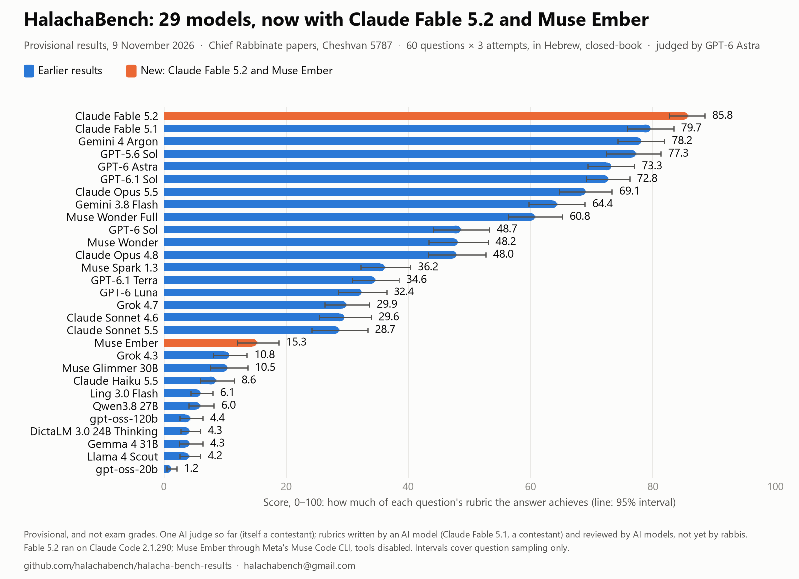

# HalachaBench v1: early results (provisional)

*1 November 2026* · Hebrew summary: [בעברית, בקצרה](#בעברית-בקצרה)

HalachaBench tests how well AI models answer real questions from the semicha (rabbinic ordination) exams of the Chief
Rabbinate of Israel. These early results cover 17 models on the **test set: the 60 questions of five papers of the
Cheshvan 5787 sitting** (Niddah, Chuppah v'Kiddushin, Mitzvot HaTeluyot BaAretz, Mikvaot, Tefillah u'Brachot), a
sitting that began on 12 October 2026. Each model answered every question three times, in Hebrew, closed-book.

> **These results are provisional, and they are not exam grades.** A score of 80 does not mean a model would pass the
> semicha exam, or that its answers can be relied on to pasken. One AI judge (GPT-6 Astra, itself a contestant) has
> graded the answers so far. The rubrics were written by an AI model and reviewed by AI models; no rabbi has reviewed
> them, and no rabbi has graded any answer yet. Six more pre-registered runs are not in this table yet and will be added
> whatever they score: Gemini 4 Argon (its usage quota ran out), Gemma 4 26B-A4B, Mistral Small 4 119B, Nemotron 3.5
> Lightning 30B, Nemotron 3.5 Super VL 120B, and a second, disclosed Qwen3.8 27B run with a larger output limit, added
> after the first run's results were seen. Four other pre-registered open-weight models (Granite 4.2 30B, Hermes 4.3
> 36B, Nanbeige4.3 33B, Olmo 3.1 32B Think) were dropped before answering any question: three did not fit the GPU at the
> registered context, and the runtime could not separate Olmo's reasoning from its answer. Claude Opus 5.5 will grade
> as a second judge. Read the caveats below before quoting a number.

## Results

Score: how much of the rubric an answer achieves, 0–100 (see [Scoring](#scoring)), averaged over 60 questions × 3
attempts. Worst of 3: the lowest of the three attempts at each question, averaged.

| # | Model | Score | 95% interval | Worst of 3 | How it ran |
|---|---|---|---|---|---|
| 1 | Claude Fable 5.1 | 79.7 | 75.8 – 83.4 | 70.4 | Claude Code CLI, effort high |
| 2 | GPT-6 Astra | 73.3 | 69.4 – 77.0 | 66.2 | Codex, effort high |
| 3 | GPT-6.1 Sol | 72.8 | 69.1 – 76.2 | 63.9 | Codex, effort high |
| 4 | Claude Opus 5.5 | 69.1 | 64.7 – 73.3 | 60.0 | Claude Code CLI, effort high |
| 5 | Gemini 3.8 Flash | 64.4 | 59.7 – 68.9 | 54.3 | Antigravity CLI, effort high |
| 6 | GPT-6.1 Terra | 34.6 | 30.8 – 38.5 | 25.6 | Codex, effort high |
| 7 | GPT-6 Luna | 32.4 | 28.5 – 36.4 | 21.8 | Codex, effort high |
| 8 | Claude Sonnet 5.5 | 28.7 | 24.2 – 33.3 | 18.3 | Claude Code CLI, effort high |
| 9 | Muse Glimmer 30B | 10.5 | 7.6 – 13.7 | 4.4 | local, llama.cpp, Q4_K_M |
| 10 | Claude Haiku 5.5 | 8.6 | 6.0 – 11.5 | 3.6 | Claude Code CLI, effort high |
| 11 | Ling 3.0 Flash | 6.1 | 4.4 – 8.0 | 0.9 | local, llama.cpp, Q4_K_M |
| 12 | Qwen3.8 27B | 6.0 | 4.1 – 8.2 | 1.6 | local, llama.cpp, UD-Q4_K_M ¹ |
| 13 | gpt-oss-120b | 4.4 | 2.6 – 6.4 | 2.1 | local, llama.cpp, MXFP4 |
| 14 | DictaLM 3.0 24B Thinking | 4.3 | 2.8 – 6.0 | 0.8 | local, llama.cpp, Q4_K_M ¹ |
| 15 | Gemma 4 31B | 4.3 | 2.5 – 6.4 | 2.0 | local, llama.cpp, Q4_K_M |
| 16 | Llama 4 Scout 17B-16E | 4.2 | 2.6 – 6.0 | 1.4 | local, llama.cpp, Q4_K_M ² |
| 17 | gpt-oss-20b | 1.2 | 0.5 – 2.1 | 0.0 | local, llama.cpp, MXFP4 |

95% intervals come from a bootstrap over questions (resampled within each paper, a question's three attempts kept
together; 10,000 replicates). They cover only the choice of questions, not judge or rubric error, which is likely
larger here. Overlapping intervals do not by themselves mean two models are tied: compared question by question, Claude
Fable 5.1 is clearly ahead of every other model (by 6.4 points over GPT-6 Astra, 95% interval 1.6 to 11.1), and gpt-oss-20b
is clearly below every other model. Not clearly apart: GPT-6 Astra, GPT-6.1 Sol and Claude Opus 5.5; GPT-6 Luna with
GPT-6.1 Terra or Claude Sonnet 5.5; Claude Haiku 5.5 with Muse Glimmer 30B or Qwen3.8 27B; and most pairs among ranks
11 to 16.

¹ Some runs produced no answer text. The model used up the output limit we set while still thinking (DictaLM 9 of 180
and Qwen3.8 27B 9 of 180; the limits were 57,088 and 65,536 tokens, the latter below what Qwen's model card allows), or
stopped after thinking without writing an answer (Qwen3.8 27B 10 of 180). Each such run was tried once more; those
still without an answer score 0, as every failed answer does.

² Llama 4 Scout failed one pre-run check: asked whether it had any tools, it claimed a web-search tool it did not have. It
ran in a sealed container with no network and no tools, so it was kept, and the failure is disclosed here.

The local models ran at 4-bit quantization on the maintainer's own hardware. gpt-oss runs in MXFP4, the precision its
weights were released in; the other local models may lose some points against full-precision versions. All 17 models
had every one of their 180 test answers scored.

## How it works

- **Questions.** The papers were transcribed twice from the page images by two Claude models (Claude Fable and Claude
  Opus), and Claude Fable 5.1 settled every difference against the image. No person has proofread the text yet. The
  questions are the Chief Rabbinate's own and are not reproduced here; the papers are published on gov.il. Item ids
  such as `5787-cheshvan-niddah-iyun-q03` name the paper, part and question.
- **Answering.** Each answer was written in a fresh process with nothing from the project but the question, the exam
  rules (answer in Hebrew, cite sources, at most 600 words; the limit is an instruction and longer answers were not cut)
  and a fixed instruction to answer closed-book. No web search. The Claude models ran with every tool switched off; 6 of
  their 726 runs still tried to call a tool and were stopped and run again. The GPT and Gemini programs cannot switch
  all their tools off, so tool use was forbidden and every run was monitored live; none of their test runs used a tool.
  A run that tried to use a tool, or ended without an answer, was run once more, and a second failure scores 0. The
  local models ran in sealed containers with no network and no tools. The prompts were not identical across programs:
  the Claude models saw only a short neutral system prompt, the GPT models also saw Codex's built-in instructions and an
  added instruction not to use tools, and the Gemini models saw Antigravity's built-in instructions.
- **Rubrics.** There is no official answer key. Each of the 60 rubrics was drafted by Claude Fable 5.1 as a rabbi would
  write one (sources, Rishonim, ruling, other accepted views, common errors), with 9–12 criteria per question: 7–11
  requirements worth points and 1–3 errors that cost points. A second Claude Fable 5.1 pass critiqued each draft and it
  was revised. Three models from three companies (Claude Fable 5.1, GPT-6 Astra, Gemini 4 Argon) then reviewed every
  rubric: changes at least two of them asked for were applied, and Claude Fable 5.1, the drafter, decided each point
  only one reviewer raised, with a written reason. Claude Opus 5.5 checked the cited sources that Sefaria carries (about
  2,000 lookups, in four rounds); sources Sefaria does not carry are marked unverified, and four minor issues were left
  open. Nobody who wrote or reviewed a rubric saw any model's answer. The rubrics were sealed with a salted cryptographic
  commitment on 29 October 2026 (the date is the seal log's own record; the commitments become public with this
  repository, and the salts that open them will be published when the review round closes), after the Claude and GPT
  models had answered and before any test answer was graded.
- **Grading.** GPT-6 Astra (effort high) decided, for every criterion of every answer that had text, whether the answer
  meets it, under one fixed judge protocol. 5% of the answers (153) were graded twice to check consistency; that result
  will be reported with the second judge.
- **Pre-registration.** The questions, exam rules and model list were recorded locally by hash before each model's
  answers were collected; the sealed rubrics, the judge protocol and the analysis code before any test answer was
  graded. Later changes are recorded as amendments with their reasons. These records are private; their hashes are
  published here for the first time, so from today they show that the records do not change, but they cannot by
  themselves prove when the records were made.

### Scoring

An answer earns the points of each requirement it meets and loses the points of each error in its question's rubric
that it makes; its score is that total divided by the total points of the requirements, times 100, kept between 0 and
100. The judge protocol also has six general checks that apply to every answer (for example, citing a source that does
not exist); they are still drafts, so the judge recorded them but they do not count in these scores. A refused, failed
or disqualified answer scores 0.

## Caveats

- **The judge is also a contestant.** GPT-6 Astra graded every answer that had text and is also on the list, as are
  other GPT models;
  a judge may prefer answers like its own. The second judge (Claude Opus 5.5) and the rabbis' grading will show how much
  this matters.
- **The rubric writer is also a contestant.** Claude Fable 5.1 drafted every rubric, made every revision, decided which
  single-reviewer suggestions to accept, and also scored highest; Claude Opus 5.5, another contestant, checked the
  rubrics' sources. A rubric written by a model may favour that model's way of answering. GPT-6 Astra, another rubric
  reviewer, is a contestant too, and Gemini 4 Argon will be once its answers are graded.
- **Not contamination-free.** Rabbinate questions often recur from earlier sittings, whose papers (and some unofficial
  answers) are online, and these 60 have not yet been checked for repeats. A model may have seen a close version of a
  question in training.
- **No rabbi has checked anything yet.** Rabbis will review the rubrics and grade a random sample of answers; their grades
  will correct the AI scores (prediction-powered inference), and the results will be called validated only if the AI
  judges agree with them well enough. Until then every number here is provisional.
- **Not a pass mark.** These scores are not a semicha exam grade, do not say whether a model "passes semicha", and are not
  authority to pasken.

## The bundle

[`bundle/`](bundle/) fixes, by hash, the data these results come from, without the exam text:

| File | What it is |
|---|---|
| `criteria.json` | Every criterion's id, points, axis and status (no criterion text) for all 96 sealed questions: the 60 test questions, and 36 development questions from the Iyar 5786 papers, which are not scored here. `approved` means approved by the AI review panel, not by a rabbi. It also lists the judge protocol's six general checks (status draft, not scored). |
| `commitments.json`, `seal-log.jsonl` | The salted commitments to all 96 sealed rubrics, and the hash-chained log that sealed them on 29 October 2026. |
| `prereg.json` | The SHA-256 of each pre-registration record. |
| `scores.json` | The judge's mean score per model. |
| `withheld.json` | The SHA-256 of the per-answer files: each answer's salted commitment, every verdict, and the 153 repeat gradings. |
| `MANIFEST.json` | The SHA-256 of every file. |
| `.gitattributes` | Keeps every file byte-exact on checkout, so the hashes match. |

Publishing every verdict now would let a rabbi who is grading blind match an answer to its model, so the per-answer
files wait for the end of the review round; `withheld.json` fixes them now. Until the code, the salts and the withheld
files are published, the bundle cannot be used to recompute a score or open a commitment: it fixes these files so that
any later change can be detected.

## Contact

halachabench@gmail.com. Anyone who would like to review the rubrics or grade answers is welcome to write. If you are
interested in collaborating on expanding the test (more papers, more models, more rabbinic review), please reach out at
the same address.

HalachaBench is an independent project, not connected to or endorsed by the Chief Rabbinate of Israel or by any model
developer; model names are their owners' trademarks.

## בעברית, בקצרה

מבחן HalachaBench בודק עד כמה מודלים של בינה מלאכותית (AI) יודעים לענות על שאלות אמיתיות ממבחני ההסמכה של הרבנות
הראשית לישראל. אלה תוצאות ראשונות של 17 מודלים על 60 השאלות של חמישה שאלונים ממועד חשוון תשפ"ז. כל מודל ענה על כל
שאלה שלוש פעמים, בעברית, בלי ספרים ובלי אינטרנט.

**התוצאות זמניות, והן אינן ציוני מבחן.** עד כה בדק את התשובות רק שופט ממוחשב אחד, GPT-6 Astra, שהוא גם אחד המודלים
הנבחנים. המחוונים נכתבו בידי Claude Fable 5.1, שקיבל את הציון הגבוה ביותר, ונבדקו בידי מודלי AI; אף רב עדיין לא עבר
עליהם, ואף רב עדיין לא בדק תשובה. שאלות רבות במבחני הרבנות חוזרות ממועדים קודמים, ועוד לא נבדק אילו מהשאלות כאן חוזרות, ולכן ייתכן שהמודלים ראו
שאלות דומות.
המודל Gemini 4 Argon ועוד חמש הרצות שנרשמו מראש עדיין חסרים, ויתווספו. הציונים אינם ציון במבחן הסמיכה, אינם קובעים
אם מודל "עובר את מבחני הסמיכה", ואין בהם היתר לסמוך על מודל בפסיקת הלכה.

כל מי שמעוניין לעבור על המחוונים או לבדוק תשובות, או לשתף פעולה בהרחבת המבחן, מוזמן לכתוב אל
halachabench@gmail.com. המיזם HalachaBench עצמאי:
אין לו קשר לרבנות הראשית לישראל, והוא אינו פועל מטעמה או בחסותה.

